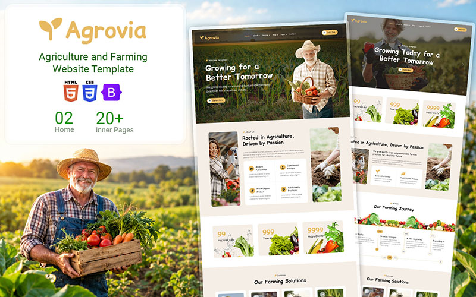

<p align="center">
  
</p>

<h1 align="center">Agrovia</h1>

<p align="center">
  <strong>Agriculture & farming website — Kabul, Afghanistan</strong>
</p>

<p align="center">
  <a href="http://emranullahrasoli.vercel.app/">Portfolio</a> ·
  <a href="mailto:emranullahrasoli@gmail.com">Contact</a> ·
  <a href="https://www.facebook.com/emranullahrasoli">Facebook</a>
</p>

<p align="center">
  
  
  
  
  
</p>

---

## About

**Agrovia** is a static multi-page website for an agriculture business based in **Kabul, Afghanistan**. It showcases farming services, team members, blog posts, testimonials, and contact information for **Emranullah Rasoli** and the Rasoli family team.

Built from a customizable HTML template and tailored with local content, Afghan business hours, and working contact/newsletter forms via FormSubmit.

## Features

| Feature | Description |
|--------|-------------|
| Multi-page site | Home, About, Services, Team, Blog, Testimonials, Contact, Features, 404 |
| Responsive UI | Bootstrap 5 layout, mobile-friendly navigation |
| Contact form | Sends messages to `emranullahrasoli@gmail.com` (FormSubmit) |
| Newsletter | Email signup with FormSubmit |
| SEO | Per-page titles, meta descriptions, and keywords |
| Social links | X, Facebook, LinkedIn, YouTube |
| Maps | Google Maps embed for Kabul |

## Pages

| Page | File |
|------|------|
| Home | `index.html` |
| About | `about.html` |
| Services | `service.html` |
| Team | `team.html` |
| Blog | `blog.html` |
| Testimonials | `testimonial.html` |
| Contact | `contact.html` |
| Features | `feature.html` |
| Not found | `404.html` |

## Project structure

```
Agrovia/
├── index.html          # Home
├── about.html
├── contact.html
├── service.html
├── team.html
├── blog.html
├── testimonial.html
├── feature.html
├── 404.html
├── css/                # Bootstrap + custom styles
├── js/main.js          # Theme scripts
├── img/                # Images
├── lib/                # WOW, animate, easing, waypoints
├── Agrovia.jpg
├── LICENSE.txt
└── READ-ME.txt
```

## Getting started

### Run locally

No build step required. Open any HTML file in a browser, or use a simple static server:

```bash
# Python 3
python -m http.server 8080

# Node (npx)
npx serve .
```

Then visit `http://localhost:8080`.

### Deploy

Works on any static host, for example:

- [Vercel](https://vercel.com)
- [Netlify](https://netlify.com)
- [GitHub Pages](https://pages.github.com)

Set the site root to the repository folder (where `index.html` lives).

## Contact

| | |
|---|---|
| **Person** | Emranullah Rasoli |
| **Location** | Kabul, Afghanistan |
| **Email** | [emranullahrasoli@gmail.com](mailto:emranullahrasoli@gmail.com) |
| **Phone** | +93 789 936 678 · +93 744 077 303 |
| **Website** | [emranullahrasoli.vercel.app](http://emranullahrasoli.vercel.app/) |

## Team

Shaban Rasoli · Nasratullah Rasoli · Houda Rasoli · Safa Rasoli · Atal Rasoli · Baryal Rasoli

## Business hours (Kabul, AFT)

- **Saturday – Wednesday:** 8:00 am – 5:00 pm
- **Thursday:** 8:00 am – 12:00 pm
- **Friday:** Closed

## Credits

- **Designed & customized by** [Emranullah Rasoli](http://emranullahrasoli.vercel.app/)
- Original HTML template: [HTML Codex — Agriculture Website Template](https://htmlcodex.com/agriculture-website-template) (see `LICENSE.txt` for template terms)

## Author

**Emranullah Rasoli**

[](http://x.com/emranullahrasol)
[](https://www.facebook.com/emranullahrasoli)
[](http://linkedin.com/emranullahrasoli)
[](http://youtube.com/emranullahrasoli)

---

<p align="center">Made with care in Kabul · Agrovia © 2025</p>
# Agrovia
